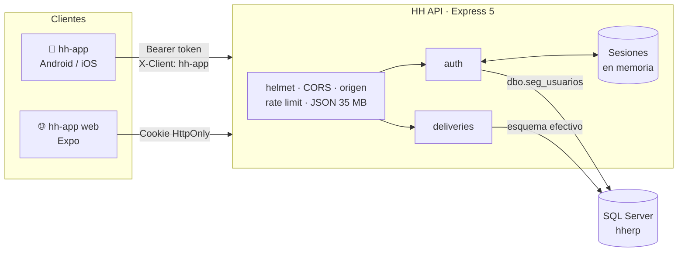
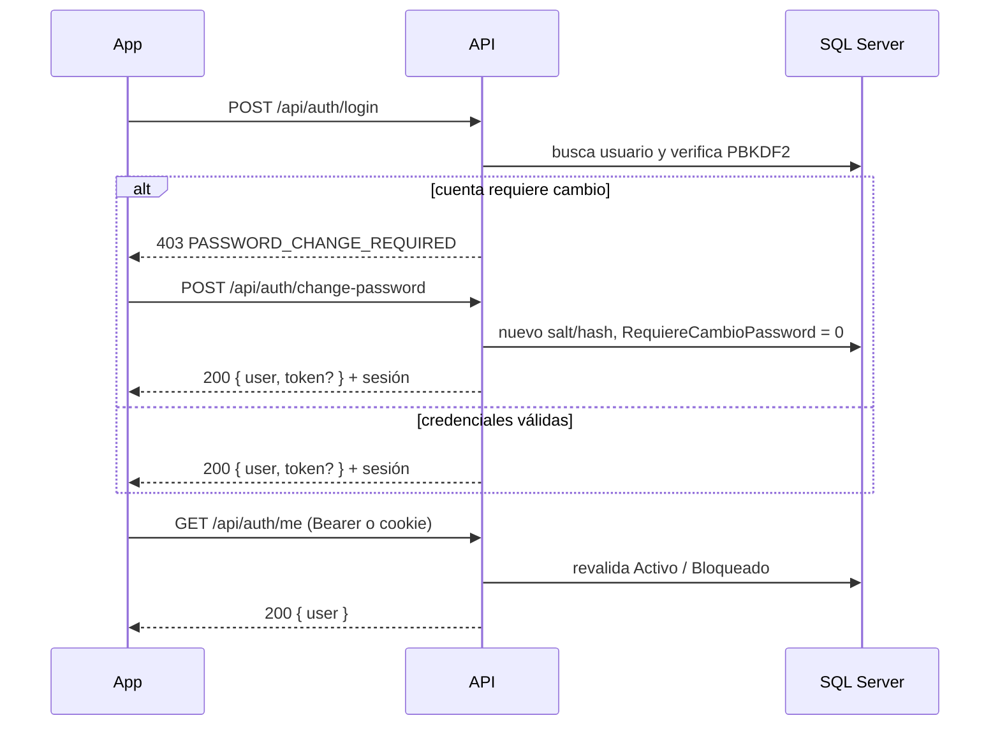
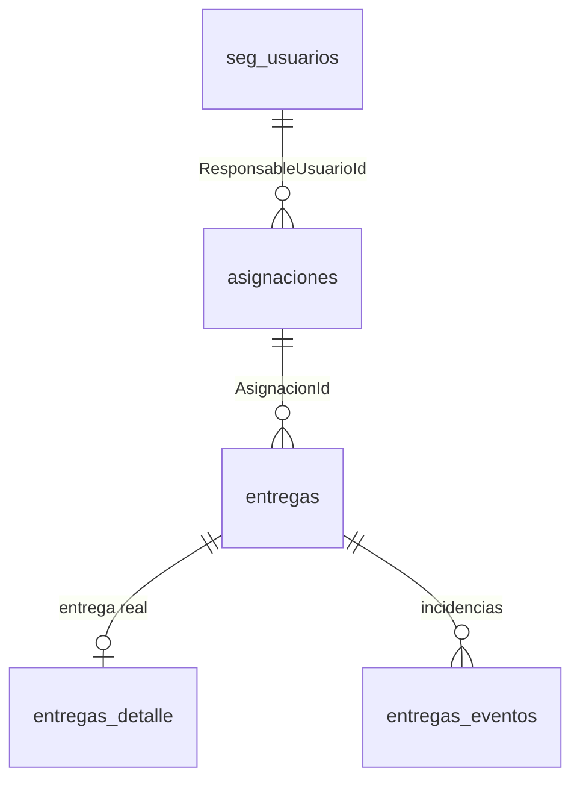

<div align="center">

# 💵 HH API

**Backend de la app móvil HH para la entrega de efectivo en ruta.**

Autenticación contra el ERP en SQL Server, consulta de bolsas asignadas y registro de entregas con firma y video como evidencia.


</div>

---

## Tabla de contenido

- [¿Qué hace?](#qué-hace)
- [Arquitectura](#arquitectura)
- [Inicio rápido](#inicio-rápido)
- [Variables de entorno](#variables-de-entorno)
- [Autenticación](#autenticación)
- [Referencia de endpoints](#referencia-de-endpoints)
- [Modelo de datos](#modelo-de-datos)
- [Seguridad](#seguridad)
- [Docker](#docker)
- [Pruebas](#pruebas)
- [Estructura del proyecto](#estructura-del-proyecto)
- [Limitaciones y siguientes pasos](#limitaciones-y-siguientes-pasos)

---

## ¿Qué hace?

| | |
| --- | --- |
| 🔐 **Login con usuarios del ERP** | Valida contra `hherp.dbo.seg_usuarios` con PBKDF2-HMAC-SHA256. No duplica usuarios. |
| 🔁 **Cambio obligatorio de contraseña** | Si la cuenta lo exige, no entrega sesión hasta que se cambia. |
| 📱 **Web y móvil** | Cookie HttpOnly para navegador; token Bearer para Android/iOS (Expo). |
| 💰 **Resumen y mini corte** | Efectivo asignado, entregado y por regresar del usuario en sesión. |
| 📦 **Bolsas pendientes** | Lista lo que falta entregar, aunque venga de días anteriores. |
| ✍️ **Entrega con evidencia** | Importe, receptor, firma en pantalla (se guarda como PNG) y video frontal (se guarda su hash). |
| ⚠️ **Incidencias** | Registro de "no entregado" con motivo e importe a regresar. |
| ♻️ **Idempotencia** | Cada registro lleva una `idempotencyKey` (UUID) para que un reintento no duplique. |

## Arquitectura



La app cliente vive en [`../hh-app`](../hh-app). Las credenciales de SQL Server **solo** existen en esta API, nunca en el frontend.

## Inicio rápido

**Requisitos:** Node.js ≥ 24 y acceso de red a la instancia de SQL Server.

```sh
npm ci
cp .env.example .env   # solo si aún no existe
# edita .env y pon DB_PASSWORD (y lo demás que aplique)
npm run dev            # http://localhost:3001 con recarga automática
```

Comprueba que está viva:

```sh
curl http://localhost:3001/api/health
# {"status":"ok"}
```

> `/api/health` solo indica que el proceso responde; **no** comprueba la conexión a SQL Server.

### Scripts

| Comando | Qué hace |
| --- | --- |
| `npm run dev` | Arranca con `--watch` y carga `.env` (obligatorio). |
| `npm start` | Arranca en modo normal; carga `.env` si existe. |
| `npm test` | Corre la suite con el runner nativo `node --test`. |

### Conectar la app desde un teléfono

1. Averigua la IP LAN de tu equipo (p. ej. `192.168.1.50`).
2. En `hh-app`, configura `EXPO_PUBLIC_API_URL=http://192.168.1.50:3001`.
3. Si también usas Expo web, su origen debe coincidir exactamente con `FRONTEND_ORIGIN`.

## Variables de entorno

La configuración se valida al arrancar ([`src/config.js`](src/config.js)): si falta algo obligatorio o un valor es inválido, la API no inicia.

| Variable | Obligatoria | Default | Descripción |
| --- | :---: | --- | --- |
| `NODE_ENV` | | — | `production` activa las validaciones de HTTPS. |
| `PORT` | | `3001` | Puerto HTTP. |
| `FRONTEND_ORIGIN` | ✅ | — | Origen web permitido, sin ruta (p. ej. `http://localhost:8081`). |
| `DB_SERVER` | ✅ | — | Host de SQL Server. |
| `DB_PORT` | | `1433` | Puerto de SQL Server. |
| `DB_NAME` | ✅ | — | Base de datos (`hherp`). |
| `DB_USER` | ✅ | — | Usuario SQL. |
| `DB_PASSWORD` | ✅ | — | Contraseña SQL. **Solo en `.env` local**, nunca en git. |
| `DB_ENCRYPT` | | `true` | Cifrado TLS hacia SQL Server. |
| `DB_TRUST_SERVER_CERTIFICATE` | | `false` | `true` solo si el servidor usa certificado autofirmado. |
| `SESSION_TTL_MINUTES` | | `480` | Duración de la sesión (1–1440). |
| `COOKIE_SECURE` | | `true` en producción | Cookie `Secure`. `false` solo para HTTP local. |
| `TRUST_PROXY_HOPS` | | `0` | Proxies inversos de confianza (0–5). Déjalo en 0 si la API se expone directo. |

> En `NODE_ENV=production` la API exige `COOKIE_SECURE=true` y un `FRONTEND_ORIGIN` con `https://`.

## Autenticación

Las sesiones son tokens opacos de 32 bytes aleatorios. El servidor solo guarda su hash SHA-256.

| Cliente | Cómo hace login | Cómo se autentica después |
| --- | --- | --- |
| **Navegador** | `POST /api/auth/login` con `credentials: 'include'` | Cookie HttpOnly `hh_session` (`__Host-hh_session` con `COOKIE_SECURE`), `SameSite=Lax` |
| **Android / iOS** | `POST /api/auth/login` con header `X-Client: hh-app` → recibe `{ token, expiresIn }` | `Authorization: Bearer <token>`; la app lo guarda en Expo SecureStore |

Si llega un header `Authorization` inválido, **no** se usa la cookie como respaldo.

### Flujo con cambio obligatorio de contraseña



Cada petición autenticada vuelve a consultar el estado de la cuenta. Si el usuario fue desactivado o bloqueado, la sesión se revoca en ese momento.

## Referencia de endpoints

Base: `http://localhost:3001`. Todos los cuerpos son JSON. 🔒 = requiere sesión.

> 📘 La especificación completa está en [`openapi.yaml`](openapi.yaml) (OpenAPI 3.0). Puedes abrirla en [editor.swagger.io](https://editor.swagger.io) (File → Import file), importarla en Postman o Insomnia, o verla localmente con:
>
> ```sh
> npx @redocly/cli@1 preview-docs openapi.yaml
> ```

| Método | Ruta | | Descripción |
| --- | --- | :---: | --- |
| `GET` | `/api/health` | | Estado del proceso. |
| `POST` | `/api/auth/login` | | Inicia sesión. |
| `POST` | `/api/auth/change-password` | | Cambio obligatorio de contraseña. |
| `GET` | `/api/auth/me` | 🔒 | Usuario de la sesión. |
| `POST` | `/api/auth/logout` | | Revoca la sesión y borra la cookie (`204`). |
| `GET` | `/api/mobile/summary` | 🔒 | Resumen y bolsas pendientes en una sola llamada. |
| `GET` | `/api/cash-cut/today` | 🔒 | Mini corte del efectivo asignado. |
| `GET` | `/api/deliveries/today` | 🔒 | Bolsas pendientes, de cualquier fecha. |
| `GET` | `/api/deliveries/history?limit=30` | 🔒 | Últimas entregas realizadas (`limit` 1–100). |
| `GET` | `/api/deliveries/:id` | 🔒 | Detalle de una entrega realizada, con firma y metadatos del video. |
| `POST` | `/api/deliveries/:id/complete` | 🔒 | Registra la entrega con evidencia. |
| `POST` | `/api/deliveries/:id/issue` | 🔒 | Registra "no entregado". |

Las rutas de entregas solo devuelven bolsas asignadas al usuario de la sesión.

<details>
<summary><b>POST /api/auth/login</b></summary>

```json
{ "username": "usuario", "password": "contraseña" }
```

Respuesta `200`:

```json
{
  "user": {
    "id": 1,
    "username": "usuario",
    "name": "Nombre Completo",
    "email": "usuario@empresa.com",
    "requiresPasswordChange": false
  },
  "token": "…43 caracteres…",
  "expiresIn": 28800
}
```

`token` y `expiresIn` solo vienen con `X-Client: hh-app`. Nunca se devuelven el hash, el salt ni la contraseña.

| Código | Cuándo |
| --- | --- |
| `400` | Faltan usuario o contraseña, o exceden la longitud permitida. |
| `401` | Credenciales incorrectas, o cuenta inactiva o bloqueada (mensaje genérico). |
| `403` | `{ "code": "PASSWORD_CHANGE_REQUIRED" }` |
| `429` | Más de 10 intentos en 15 minutos desde la misma IP. |

</details>

<details>
<summary><b>POST /api/auth/change-password</b></summary>

```json
{ "username": "usuario", "currentPassword": "actual", "newPassword": "nueva-de-8+" }
```

- `newPassword`: entre 8 y 128 caracteres y diferente de la actual.
- Solo funciona si la cuenta tiene `RequiereCambioPassword = 1`; si no, responde `409`.
- Si sale bien, devuelve lo mismo que el login (sesión nueva).
- Comparte el límite de intentos con `/login`.

</details>

<details>
<summary><b>GET /api/mobile/summary</b> y <b>GET /api/cash-cut/today</b></summary>

```json
{
  "summary": {
    "assignedAmount": 15000,
    "deliveredAmount": 9000,
    "returnAmount": 6000,
    "totalDeliveries": 5,
    "pendingDeliveries": 2,
    "completedDeliveries": 3,
    "issueDeliveries": 0
  },
  "pending": [ /* Delivery[] */ ],
  "today":   [ /* igual a pending (compatibilidad) */ ]
}
```

`/api/cash-cut/today` devuelve solo `{ summary }`.

</details>

<details>
<summary><b>Objeto Delivery</b></summary>

```json
{
  "id": "123",
  "assignmentId": "45",
  "clientId": "678",
  "clientName": "Cliente S.A. de C.V.",
  "clientRfc": "XAXX010101000",
  "scheduledAmount": 3000,
  "deliveredAmount": null,
  "returnAmount": 3000,
  "receiverName": null,
  "status": "PENDIENTE",
  "issueReason": null,
  "observations": null,
  "createdAt": "2026-10-13T14:00:00.000Z",
  "completedAt": null,
  "eventAt": null
}
```

`status` puede ser `PENDIENTE`, `ENTREGADA` o el tipo del último evento registrado (p. ej. `NO_ENTREGADO`). Los IDs se devuelven como string porque en SQL son `BIGINT`.

`GET /api/deliveries/:id` agrega:

```json
{
  "signature": { "mimeType": "image/png", "base64": "iVBORw0…", "hashSha256": "ab12…" },
  "video": { "id": "uuid", "extension": ".mp4", "mimeType": "video/mp4", "sizeBytes": 4200000, "hashSha256": "cd34…" }
}
```

</details>

<details>
<summary><b>POST /api/deliveries/:id/complete</b></summary>

```json
{
  "amountDelivered": 3000,
  "receiverName": "Juan Pérez",
  "signatureStrokes": [[{ "x": 0.10, "y": 0.50 }, { "x": 0.35, "y": 0.42 }]],
  "videoBase64": "AAAAIGZ0eXBpc29t…",
  "videoMimeType": "video/mp4",
  "videoSizeBytes": 4200000,
  "observations": "Opcional, máx. 2000",
  "idempotencyKey": "3f1c2a9e-7b4d-4c1e-9a2b-5d6e7f8a9b0c"
}
```

| Campo | Regla |
| --- | --- |
| `amountDelivered` | Número entre 0 y 99,999,999. |
| `receiverName` | 1–400 caracteres. |
| `signatureStrokes` | Arreglo de trazos con coordenadas normalizadas 0–1. Al menos un trazo de 2 o más puntos. Se convierte en un PNG de 640×260. |
| `videoMimeType` | `video/mp4` o `video/quicktime`. |
| `videoSizeBytes` | Entero entre 1 KB y 21 MB. |
| `videoBase64` | Máximo 28,000,000 caracteres. |
| `idempotencyKey` | UUID. |

Responde `201 { "ok": true }`, `404` si la bolsa no existe o no es tuya, y `409` si ya estaba registrada.

</details>

<details>
<summary><b>POST /api/deliveries/:id/issue</b></summary>

```json
{
  "reason": "Cliente cerrado",
  "returnAmount": 3000,
  "observations": "Opcional",
  "idempotencyKey": "uuid"
}
```

Inserta un evento `NO_ENTREGADO`. Responde `201`, o `404` si la bolsa no existe, no es tuya o ya fue entregada.

</details>

### Errores comunes

Todas las respuestas de error tienen la forma `{ "message": "…" }`.

| Código | Significado |
| --- | --- |
| `400` | Cuerpo inválido o JSON mal formado. |
| `401` | Sin sesión, o sesión revocada o expirada. |
| `403` | Origen no permitido (CORS / `Sec-Fetch-Site`). |
| `404` | Ruta o entrega no encontrada. |
| `413` | Cuerpo mayor a 35 MB. |
| `503` | Falla al hablar con SQL Server u otro error interno (no se filtran detalles). |

## Modelo de datos



| Tabla | Uso |
| --- | --- |
| `dbo.seg_usuarios` | Usuarios, hash/salt/iteraciones, `Activo`, `Bloqueado`, `RequiereCambioPassword`. |
| `efectivo.asignaciones` | Asignación de efectivo a un responsable. |
| `efectivo.entregas` | A quién y cuánto entregar (snapshot del cliente y su RFC). |
| `efectivo.entregas_detalle` | Una fila por entrega realizada: importe, receptor, firma PNG (binario y SHA-256) y metadatos del video. |
| `efectivo.entregas_eventos` | Eventos como `NO_ENTREGADO`, con motivo e importe liberado. |

> 📹 La tabla actual **no** guarda el binario del video, solo `VideoId`, extensión, MIME, tamaño y `VideoHashSha256`. Si se agrega una columna para el contenido, hay que mapearla en [`src/modules/deliveries/repository.js`](src/modules/deliveries/repository.js).

## Seguridad

- **Contraseñas:** PBKDF2-HMAC-SHA256 que respeta el salt, las iteraciones y la longitud de cada registro. Las contraseñas nuevas usan 150,000 iteraciones y salt de 32 bytes. La comparación es de tiempo constante, y para usuarios inexistentes se calcula un hash ficticio, así que el tiempo de respuesta no revela qué usuarios existen.
- **Nombres ambiguos:** si un `Usuario` coincide con más de una fila, no se autentica.
- **SQL:** todas las consultas están parametrizadas. Fuera del cambio de contraseña, la API no modifica `seg_usuarios` (no toca `IntentosFallidos` ni `UltimoLoginUtc`).
- **Rate limit:** 10 intentos por IP cada 15 minutos en `/login` y `/change-password`.
- **Origen:** rechaza cualquier `Origin` distinto de `FRONTEND_ORIGIN` y cualquier escritura con `Sec-Fetch-Site: cross-site`.
- **Headers:** `helmet`, sin `X-Powered-By` y `Cache-Control: no-store` en todas las respuestas.
- **Sesiones:** máximo 10,000 activas; se limpian las expiradas cada minuto.
- **Errores:** mensajes genéricos al cliente; en los logs solo se registra el código del error.

## Docker

```sh
docker compose up --build -d
docker compose logs -f api
```

- La imagen (`node:24-bookworm-slim`) **no contiene secretos**: Compose inyecta `.env` al ejecutar.
- Corre como usuario `node`, con sistema de archivos de solo lectura, `cap_drop: ALL` y `no-new-privileges`.
- Tiene un healthcheck integrado contra `/api/health`.
- El puerto se publica solo en `127.0.0.1`. Para exponerla, ponla detrás de un proxy inverso con HTTPS y ajusta `TRUST_PROXY_HOPS`.

## Despliegue automático (GitHub Actions + Portainer)

Cada push a `main` despliega solo, sin que GitHub tenga que conectarse a la red local:

```
push a main ──► GitHub Actions: npm test ──► imagen ghcr.io/ragde49/apihh:latest ──► mueve rama production
                                                                                          │
                     Portainer (red local) revisa production por polling ◄────────────────┘
                     └─► descarga la imagen nueva y recrea el contenedor
```

- Workflow: [`.github/workflows/deploy.yml`](.github/workflows/deploy.yml). Si las pruebas fallan, no se publica nada.
- Stack: [`portainer-stack.yml`](portainer-stack.yml). Las variables se capturan en Portainer, no en el repo.
- Cada imagen también se etiqueta con el SHA del commit (`ghcr.io/ragde49/apihh:<sha>`) para poder regresar a una versión anterior.

## Pruebas

```sh
npm test
```

16 pruebas con `node:test`, usando repositorios en memoria (no requieren SQL Server). Cubren login por cookie y Bearer, rotación y revocación de sesiones, cuentas inactivas o bloqueadas, cambio obligatorio de contraseña, rate limit, origen cruzado, fallas de base de datos, expiración de sesiones y validación de evidencia en las entregas.

## Estructura del proyecto

```
hh-api/
├── src/
│   ├── server.js                  # arranque y apagado ordenado (SIGINT/SIGTERM)
│   ├── app.js                     # rutas, middlewares y validación
│   ├── config.js                  # lectura y validación de variables de entorno
│   ├── database.js                # pool de mssql con conexión perezosa
│   └── modules/
│       ├── auth/
│       │   ├── password.js        # PBKDF2: verificar y generar hash
│       │   ├── repository.js      # consultas a dbo.seg_usuarios
│       │   └── sessions.js        # almacén de sesiones en memoria
│       └── deliveries/
│           ├── repository.js      # consultas al esquema efectivo
│           └── signature.js       # trazos → PNG
├── test/auth.test.js
├── .github/workflows/deploy.yml   # CI/CD: pruebas → imagen GHCR → rama production
├── openapi.yaml                   # especificación OpenAPI / Swagger
├── portainer-stack.yml            # stack de producción para Portainer
├── Dockerfile
├── compose.yaml
└── .env.example
```

## Limitaciones y siguientes pasos

- **Sesiones y rate limit en memoria:** reiniciar la API cierra todas las sesiones y reinicia los contadores. Antes de correr varias réplicas hay que moverlos a un almacén compartido (p. ej. Redis).
- **Video:** hoy solo se guardan los metadatos y el hash, no el archivo.
- **Pendiente:** registro público, recuperación de contraseña y autorización por módulos o roles.
